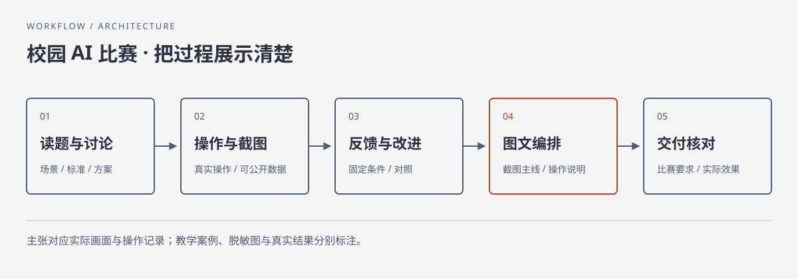

# Campus AI Competition

**把真实的 AI 使用过程，做成看得懂、跟得上的校园参赛材料。**

一个中文 Agent Skill：从选题讨论、作品实现到原样截图、图文编排与交付检查。适合 AI 提效案例、工具应用和开发流程展示，尤其适合需要用清晰画面向非专业读者解释作品的场景。



## 它帮你完成什么

| 你带来的材料 | Skill 推进的工作 | 可以交付的结果 |
| --- | --- | --- |
| 比赛通知和一个模糊想法 | 围绕关键决策追问，明确场景、输入、操作与验证方式 | 可执行的作品与演示方案 |
| 已有作品和反馈 | 验证核心流程，保留同条件前后画面 | 可追溯的改进说明 |
| 截图、草稿或比赛模板 | 用真实画面串起操作，精炼正文与图注 | 用户约定的 Word、PDF 或其他图文材料 |
| 一个待提交的压缩包 | 解压核对入口、路径、引用与实际文件 | 与正文一致的提交包 |

作品开发、截图和文档导出由所在 Agent 的实际工具完成；本仓库提供决策与检查流程，不附带截图程序、渲染引擎或成品模板。算法排行榜、科研创新竞赛应按各自规则组织证据，不直接套用此展示流程。

## 快速开始

下载或克隆本仓库，将**整个仓库文件夹**命名为 `campus-ai-competition`，放进 Agent 的技能目录。根目录应直接包含 `SKILL.md`，不要再套一层同名目录。

| 环境 | 安装位置 | 使用方式 |
| --- | --- | --- |
| Codex | 项目的 `.agents/skills/campus-ai-competition/`，或个人 `~/.agents/skills/campus-ai-competition/` | `$campus-ai-competition` 加具体任务 |
| Claude Code | 项目的 `.claude/skills/campus-ai-competition/`，或个人 `~/.claude/skills/campus-ai-competition/` | `/campus-ai-competition` 加具体任务 |
| DeepSeek harness（dsh） | 项目 `.dsh/skills/campus-ai-competition/` 或 `.agents/skills/campus-ai-competition/`；个人 `~/.dsh/skills/campus-ai-competition/` | 启用原生 Skill 提供方后按名称调用；本仓库仅核对官方文档，未作运行实测 |
| 其他 Agent | 放在 Agent 可读取的目录，保留相对路径 | 显式要求读取 `SKILL.md` |

Windows 中 `~` 表示当前用户目录。个人目录适合复用，项目目录适合仅对一个项目生效。若已有同名技能，先备份，再比较更新；仓库根目录的 `agents/openai.yaml` 是 Codex 界面元数据，其他 Agent 可忽略。

```text
使用 campus-ai-competition。我有比赛通知和一个现有作品，
请先读规则与材料，整理还缺的关键决定，再按已确认的范围推进。
最终只交付规则要求的 PDF；截图保留原样，图注解释动作与结果。
```

通用 Agent 可以这样调用：

```text
请读取 <仓库目录>/SKILL.md，并按任务需要读取它链接的参考文件。
参考文件里的案例只是示例。我的任务是：……
```

## 一次使用的路径

1. **读题与定范围**：区分比赛硬性要求、用户选择和建议。已有明确决定直接承接；不重复盘问。
2. **真实执行与截图**：采集关键输入、操作和结果。先看代表性样图，按用户已授权的节奏继续。
3. **落实反馈**：把反馈变成具体改动；尽量固定数据、视口和条件，保留可比的前后画面。
4. **写成可跟做的材料**：图下解释动作和看点，正文补齐必要入口与因果。以事实替代口号和笼统自我否定。
5. **预览与交付核对**：查看最终格式；正文里承诺的入口、附件和文件都与实际交付一致。

若只需要润色已有报告，就从现有材料继续，不重新开发作品。详情见 [Skill 入口](SKILL.md)。

## 一个直观的写作示例

下面是**合成示例**，不代表实测成效或真实比赛经历。

| 原表达 | 已知证据 | 更合适的表达 |
| --- | --- | --- |
| “AI 全面赋能，显著提升活动查询效率，但仍有诸多不足。” | 已验证按日期筛选；没有耗时测量 | “选择日期后，页面只显示当天活动。” |

完整的[合成教学案例](references/synthetic-examples.md)演示了概念解释、作品改进和提交包核对；[写作规则](references/writing.md)说明如何使用自然表达及证据充分的结果叙事。真实成果图需要来自本次操作，本仓库不把示意图或生成图包装成应用截图。

## 换一台电脑需要什么

Skill 本身是 Markdown 与 YAML，没有运行脚本、API 密钥、包安装步骤或强制外部 Skill 依赖。能读取文件的 Agent 就能使用其讨论和写作流程。

实际做作品时，再按交付格式准备浏览器或应用操作能力、截图工具，以及 Word/PDF 等生成与预览工具。缺少工具时先说明具体影响，可以继续的文案与核对工作仍继续；没有截图或最终预览，就不标记该阶段已完成。完整说明见 [兼容与环境](docs/compatibility.md)。

## 公开材料与安全

公开截图前使用可公开数据和测试账号，避免带入个人聊天、账号、通知和私密路径。需要脱敏时优先重新采集；经用户选择使用脱敏副本，要注明其性质。公开范围与比赛提交范围分别按用户要求判断。

仓库只保留合成教学案例，不分发原始私人对话。安全检查和场景检查的范围见 [验证说明](docs/validation.md)。自动扫描与源文件审查不能保证未来工具、输入材料或外部服务绝对安全。

## 来源

写作指导吸收 [Humanizer-zh](https://github.com/op7418/Humanizer-zh) 与 [anti-defensive-writing-Skill](https://github.com/Adkid-Zephyr/anti-defensive-writing-Skill) 的适用思路，并针对比赛改写；不要求安装它们，不承诺规避 AI 检测。详见 [来源与许可](docs/sources.md)。
